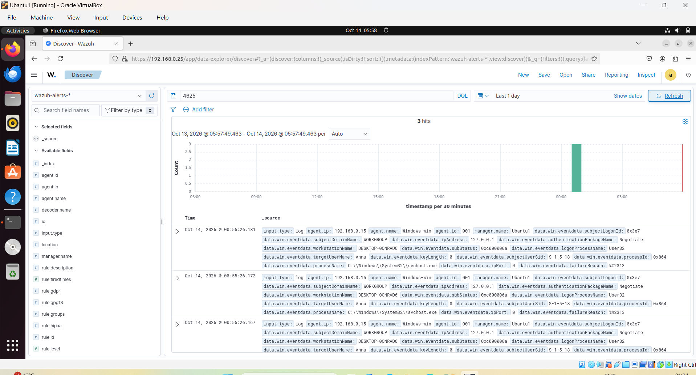
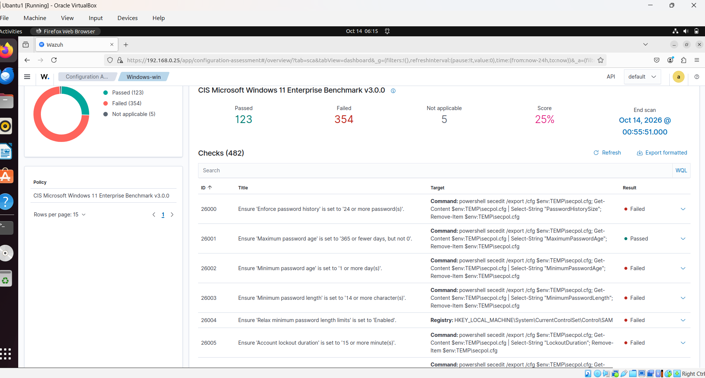
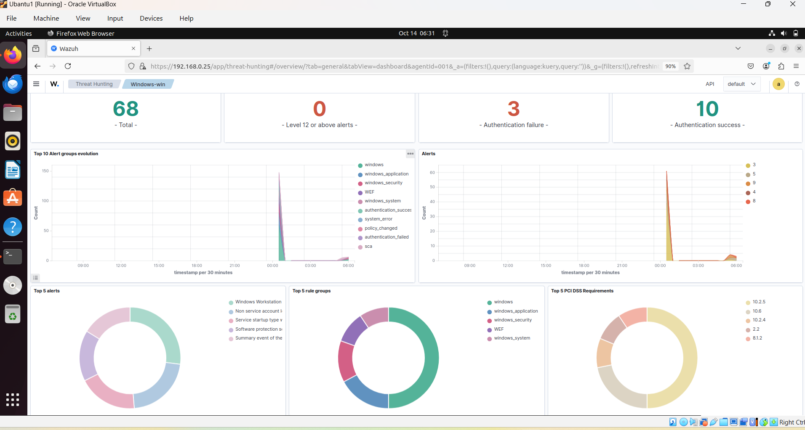

**Project Overview**
This project demonstrates the deployment and configuration of a Security Information and Event Management (SIEM) solution using Wazuh.

The objective was to monitor a Windows 11 endpoint from a Linux-based Wazuh server and analyze security events in real time.

Technologies Used
Wazuh 4.14.8
Ubuntu Linux
Windows 11
VirtualBox
OpenSearch Dashboard
Architecture
Windows 11 Endpoint | | Wazuh Agent | Ubuntu Wazuh Manager | Wazuh Dashboard

Features
Endpoint monitoring
Security event collection
User account monitoring
Log analysis
Threat hunting

**Agent Status**
The Windows endpoint was successfully enrolled and connected to the Wazuh Manager.

**Event Detection**
Test User Creation
The following alert was generated after creating a Windows account called testuser.

**Lab User Creation**
The following alert was generated after creating a Windows account called labuser.

screenshots/labuser-event.png

**Failed Login Detection**
To test authentication monitoring, multiple invalid login attempts were performed on a Windows user account.

Wazuh successfully detected the failed login attempts and generated Windows Security Event ID 4625.

**Security Configuration Assessment (SCA)**
Wazuh was used to assess a Windows 11 Home endpoint against the CIS Microsoft Windows 11 Benchmark.

Results
Passed Checks: 123
Failed Checks: 354
Security Score: 25%
The assessment identified multiple areas for security hardening, including password policy and account lockout configurations.

**Threat Hunting Dashboard**
The Wazuh Threat Hunting dashboard was used to monitor and investigate security events generated by the Windows 11 endpoint.

Dashboard Highlights
Total Events: 68
Authentication Failures: 3
Authentication Successes: 10
Real-time alert visualization
Event trend analysis

**Skills Demonstrated**
SIEM Administration
Wazuh Deployment
Windows Security Monitoring
Event Log Analysis
Threat Hunting
Security Alert Investigation
Linux Administration
Endpoint Monitoring
